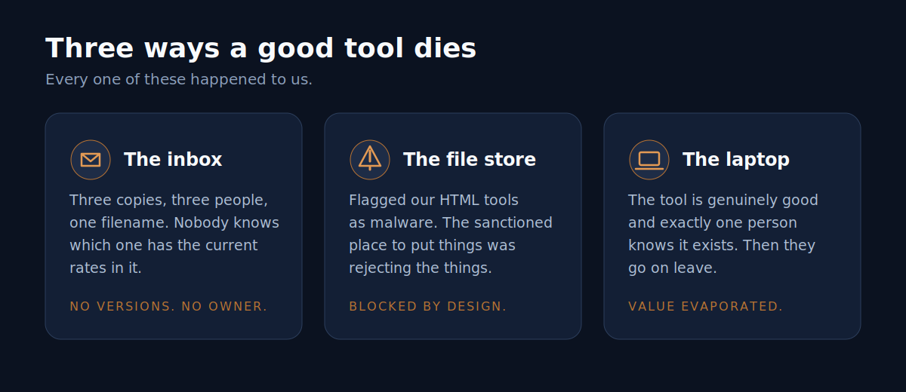
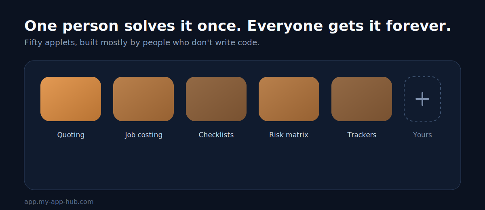

Someone on my team emailed me an app.

Not a link. Not a repo. An actual `.html` file, attached to an email, with the message: "made this, it works, have a play."

It was a quoting tool. Rough around the edges, but it did the job — punch in a few numbers, get a price out. She'd built it in an afternoon with an AI, without ever writing a line of code in her life. And it was better than the spreadsheet it replaced.

Then someone else edited it. Emailed it back around. Now there were three versions floating in three inboxes, all called `quote-tool.html`, and nobody could tell you which one had the current rates in it.

That's the moment AppHub started.

## The problem nobody warns you about

I lead AI adoption at a marine services business. Small team — around fourteen people, most of them not technical, most of them working out of a workshop or standing on a dock rather than sitting in front of an IDE.

We rolled AI out properly. Policy signed, everyone onboarded, licences paid for. And it worked. I expected the productivity. I expected people to write faster emails and better reports.

What I did not expect was that people would start *building things*.

Once you give a non-developer a model that can write working code, they don't just ask it questions. They ask it for tools. A checklist that calculates something. A form that generates a document. A tracker for the thing they've been tracking badly in a spreadsheet for six years. They know exactly what they need, because they're the ones doing the work — they just never had a way to make it before.

So they made it. And then they had nowhere to put it.

## Three ways a good tool dies

**The inbox.** The default way to move a file, and a disaster for anything living. No versions, no ownership, no way to know if the copy you opened is the copy that's current.

**The file store.** Ours flagged the HTML files as malware. Which, to be fair, is not an unreasonable thing for a corporate document store to do when a pile of unsigned HTML with embedded JavaScript suddenly appears in it. But it meant the sanctioned place to put things was actively rejecting the things people were making.

**The laptop.** The quiet one. The tool exists, it's genuinely good, and exactly one person knows about it. When they're on leave, or on a job, or they leave the company, it goes with them. Value created, value evaporated.

The common thread: the AI had solved the hard part — building the thing — and left the boring part completely unsolved. Getting it to the people who need it, keeping it current, and making sure it doesn't die when someone changes laptops.

The boring part is where the value actually lives.

## What I built

AppHub is a place to put them.

Each tool is a single self-contained HTML file. You upload it, it appears as a tile on a grid that looks like a phone home screen, and anyone in your toolbox can open it and use it. No install, no build step, no deployment pipeline, no explaining what npm is to a dive supervisor. It's versioned, so you can roll back when someone breaks it. It's shared, so it isn't trapped on one machine. It has storage, so the data survives the browser closing.

That's it. That's the whole idea.

It's deliberately not a developer platform. Developers already have GitHub, and they're not the ones with the problem. The person with the problem is the operations manager who just made something genuinely useful in an hour and has no idea how to get it to the other twelve people who'd use it daily.

## What actually happened next

We're at about fifty applets now.

Some are exactly what you'd expect — job costing, checklists, document number generators. Some I would never have thought to build, because I don't do those people's jobs and I don't feel the friction they feel. That's the point I keep coming back to. The best tools in there weren't built by me. They were built by the person who was annoyed.

The compounding effect is the bit I underestimated. Every applet is a conversation with an AI, crystallised into something reusable. One person solves their problem once, and twelve other people get it for free, forever. The tools stop decaying back into the inbox.

And there's a cultural thing I didn't design for. When your tools sit on a grid where everyone can see them, building one becomes visible. People started poking around, opening things they didn't build, then thinking *hang on, I could make one of those.* The barrier was never technical. It was permission, and a place to land.

## The honest summary

I didn't build AppHub because I had a SaaS idea. I built it because my team kept making good things, and those good things kept dying in email attachments, and it drove me mad.

Turns out that's not a problem unique to us. Every organisation adopting AI properly is about to hit the same wall — the moment your people stop consuming AI output and start producing tools with it, you need somewhere for those tools to live.

That's what AppHub is. Somewhere to put them.
